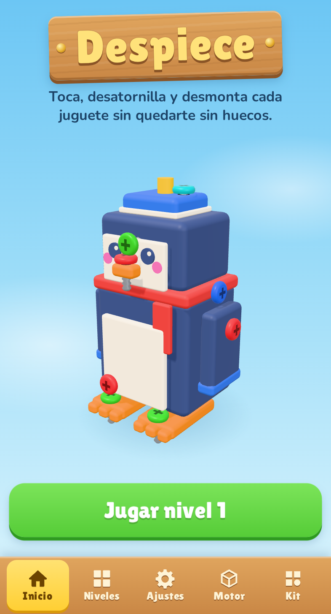
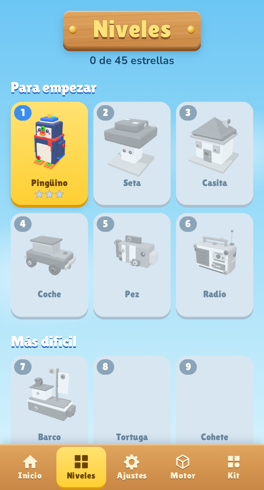
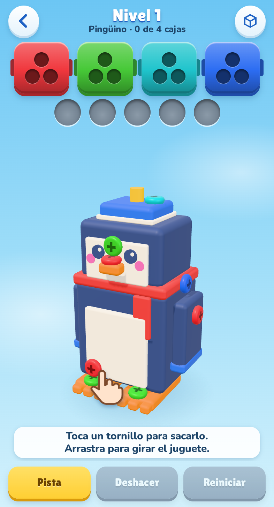
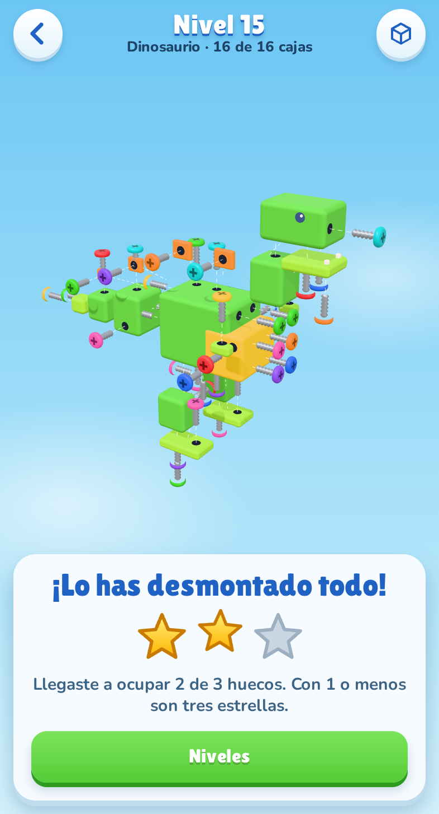
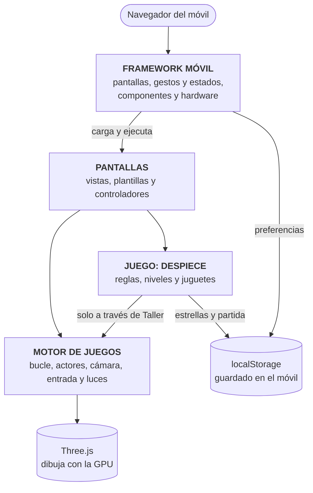
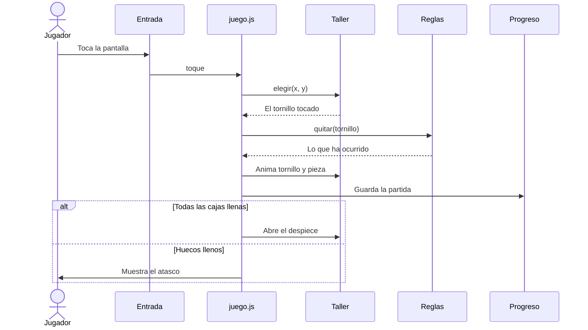

# Telón y Despiece

> Proyecto del **RA4** · 0489 Programación multimedia y dispositivos móviles · DAM
> *«Crea tu propio framework móvil»*

**Telón** es un framework móvil hecho desde cero con HTML, CSS y JavaScript. **Despiece** es el juego que lo demuestra: un puzle 3D en el que desatornillas 15 juguetes, cada vez más difíciles.

**Juega aquí: <https://tornillos3d.serenaesteve.com>**

Se abre en el navegador del móvil, se puede instalar como una app y funciona sin conexión.

<p>
  
  
  
  
</p>

---

## Cómo se juega

1. **Toca un tornillo** para sacarlo. Si hay una caja abierta de su color, va a ella; si no, espera en un hueco.
2. **Arrastra** para girar el juguete y **pellizca** para acercarlo. Hay tornillos por todas las caras.
3. Cuando una pieza se queda sin tornillos, **cae** y deja a la vista lo que tapaba.
4. **Ganas** al sacar todos los tornillos. **Te atascas** si se llenan los huecos de espera.

Consigues tres estrellas si terminas sin ayudas y con holgura. *Pista* y *Deshacer* dejan el nivel en una.

Cada nivel es un juguete distinto: pingüino, seta, casita, coche, pez, radio, barco, tortuga, cohete, castillo, conejo, camión, molino, elefante y dinosaurio.

---

## Qué es Telón

Une en un solo proyecto las dos cosas que hemos construido en clase: el framework de vistas `jocarsa | móvil` y el motor de juegos (`Actor`, `Escena`, `Motor`…), llevado a 3D con Three.js. Se divide en dos capas, y el juego va aparte:

| Capa | Dónde | Qué hace |
|---|---|---|
| **Framework móvil** | `controlador.js`, `componentes.js`, `dispositivo.js`, `sw.js` | Pantallas, componentes `ui-*`, gestos, historial, estados de la app, hardware y modo sin conexión |
| **Motor de juegos** | `js/motor/` | Bucle, actores, cámara, entrada táctil, luces, partículas, sonido e inspector de escena |
| **El juego** | `js/juego/` | Reglas, niveles y juguetes. El motor no sabe nada de tornillos, y una prueba automática lo comprueba |

Sirve para más que este juego:

- **La pestaña Motor** es una escena de bloques que no usa nada de `js/juego/`.
- **La pestaña Kit** enseña los componentes del framework. Están las 17 plantillas del framework de clase y 3 propias.
- **La vista de productos de clase** funciona aquí tal cual: `vistas/productos.html` y `controladores/productos.js` están copiados sin cambios.

### Pensado para un móvil

- **Toque, arrastre y pellizco** se distinguen entre sí, y se puede deslizar entre pestañas.
- **Se adapta** a pantallas de 280 a 932 px, en vertical, en horizontal y en tablet, respetando la muesca.
- **Estados de la app:** activo, pausa y destruido. La partida se guarda en cada jugada y sigue donde estaba al volver.
- **Ahorra batería:** con la escena quieta no se dibuja nada, y en segundo plano se detiene.
- **Si el móvil va lento,** quita las sombras y baja la resolución él solo.
- **Hardware:** vibración, inclinación, sonido y pantalla siempre encendida, comprobando antes si el móvil los permite.

---

## Mapa de arquitectura

Cada flecha significa «usa a». El juego usa al motor, pero el motor no sabe que existe el juego.



**Qué hay en cada capa**

| Capa | Módulos | Regla |
|---|---|---|
| **Framework móvil** | `Telon` (`controlador.js`), `Componentes`, `Dispositivo`, `sw.js` | No sabe nada de juegos. Sirve para cualquier app, como la vista de productos de clase |
| **Pantallas** | `vistas/`, `templates/`, `controladores/` | Es donde se conecta todo: cada controlador usa lo que necesita de las otras capas |
| **Juego** | `Reglas`, `Modelos`, `Niveles`, `Progreso`, `Taller`, `Tinta` | `Reglas` no usa gráficos, y por eso se pueden simular miles de partidas sin dibujar nada. `Taller` es el único módulo que toca el motor |
| **Motor** | `Motor`, `Escena`, `Actor`, `Particulas`, `Camara`, `Entrada`, `Estudio`, `Geometrias`, `Recursos`, `Sonido`, `Inspector` | No conoce el juego, y una prueba automática lo comprueba |

Hay dos conexiones pequeñas con el framework que el mapa no dibuja: `Tinta`, del juego, lee las preferencias de `Dispositivo`, e `Inspector`, del motor, usa `Componentes.escapar()`.

### Qué pasa al abrir una pantalla

1. `Telon.navegar("juego", { lamina: 3 })` guarda la ruta en el historial.
2. Carga `vistas/juego.html`, y `Componentes` convierte cada `ui-*` usando su plantilla, que pide una sola vez.
3. Carga `controladores/juego.js` y mueve el carrusel hasta la pantalla nueva.
4. Destruye la pantalla anterior y ejecuta el controlador de la nueva.

### Qué pasa al tocar un tornillo



`juego.js` es `controladores/juego.js`. Además de lo que se ve aquí, pinta las cajas y los huecos, y hace sonar y vibrar el móvil. Si el dedo se ha movido, `Entrada` no lo cuenta como toque, sino como arrastre, y gira la cámara.

Las reglas deciden y el taller dibuja: `Reglas` nunca toca un gráfico, y `Taller` nunca decide quién gana.

---

## Ejecutarlo en tu ordenador

No hay que instalar nada: Three.js y las fuentes vienen incluidos. Solo hace falta un servidor, porque el navegador no deja cargar las vistas abriendo `index.html` con doble clic. Dentro de la carpeta del proyecto:

```bash
python3 -m http.server 8000
```

Abre <http://localhost:8000> y activa el modo de dispositivo móvil del navegador (`F12` y luego `Ctrl + Shift + M`).

---

## Usar el framework

### Crear una pantalla

Crea `vistas/saludo.html`:

```html
<ui-seccion titulo="Hola">
  <ui-boton id="vibrar" class="boton-primario">Vibrar</ui-boton>
</ui-seccion>
```

Si necesita lógica, crea `controladores/saludo.js`. Recibe `contenedor` y `parametros`:

```js
contenedor.querySelector("#vibrar").onclick = () => Dispositivo.vibrar(30);

// Opcional: una función de limpieza, como en clase, o un objeto con el ciclo de vida.
return {
  alPausar() { /* la app pasa a segundo plano */ },
  alReanudar() { /* vuelve */ },
  alDestruir() { /* se cierra la pantalla */ },
};
```

Se abre con `Telon.navegar("saludo")`. Con `Telon.navegar("saludo", { id: 3 })`, el controlador recibe `parametros.id`. Para que funcione sin conexión, añade los archivos nuevos a la lista de `sw.js`.

### Crear un componente

Añade `templates/nombre.html` y escribe `<ui-nombre>`. Los atributos llegan como `{{atributo}}`, lo de dentro como `{{contenido}}` y el resto, como `id` o `data-*`, por `{{attrs}}`:

```html
<span class="badge {{class}}" {{attrs}}>{{contenido}}</span>
```

### API

| Llamada | Qué hace |
|---|---|
| `Telon.navegar(vista, parametros)` | Abre una vista y la añade al historial |
| `Telon.reemplazar(vista, parametros)` | Abre una vista sin añadirla al historial |
| `Telon.volver(alternativa)` | Vuelve atrás, o a `alternativa` si no hay historial |
| `Telon.estado` / `Telon.estados` | Estado de la app (`activo`, `pausa`, `destruido`) y su registro |
| `Componentes.renderizar(elemento)` | Convierte los `ui-*` que haya dentro de un elemento |
| `Dispositivo.vibrar(patron)` | Vibra, si el móvil y las preferencias lo permiten |
| `Dispositivo.mantenerPantalla(activa)` | Evita que la pantalla se apague |
| `Dispositivo.capacidades()` | Lista el hardware disponible |
| `Dispositivo.preferencias` / `guardarPreferencia(n, v)` | Preferencias guardadas |

### Crear otro juego con el motor

Un bloque que gira y cambia de color al tocarlo. El ejemplo completo está en [`pruebas/comparativa/telon.html`](pruebas/comparativa/telon.html):

```js
const motor = new Motor(document.querySelector("#lienzo"));
const escena = new Escena();
motor.cargar(escena);
escena.camara.encuadrar(2);
Estudio.montar(motor, escena, { radio: 2 });

const material = new THREE.MeshStandardMaterial({ color: "#f0373d" });
const bloque = new Actor({ objeto: new THREE.Mesh(new THREE.BoxGeometry(1.4, 1.4, 1.4), material) });
bloque.agregarComportamiento((actor, dt) => { actor.objeto.rotation.y += dt; });
escena.agregar(bloque);

motor.entrada.al("toque", ({ x, y }) => {
  if (escena.lanzarRayo(x, y, [bloque]).length) material.color.set("#2c6df2");
});
motor.iniciar();
```

---

## Estructura

```text
├── index.html            carga todo, en orden
├── controlador.js        navegación, carrusel, gestos, historial y estados
├── componentes.js        motor de componentes ui-*
├── dispositivo.js        hardware, preferencias e instalación
├── sw.js                 modo sin conexión
├── estilo.css
├── vistas/               una plantilla por pantalla
├── controladores/        la lógica de cada pantalla
├── templates/            los componentes ui-*
├── js/motor/             motor genérico
│   ├── Motor.js          lienzo, tiempo, bucle y calidad adaptativa
│   ├── Escena.js         actores, grafo, animaciones, colisiones y rayos
│   ├── Actor.js          la unidad de todo lo que hay en escena
│   ├── Camara.js         cámara orbital para pantalla vertical
│   ├── Entrada.js        toques, arrastres, pellizco, teclado e inclinación
│   ├── Estudio.js        reflejos, luces y sombras
│   ├── Geometrias.js     cajas redondeadas y fusión de geometrías
│   ├── Particulas.js     partículas con depósito fijo
│   ├── Recursos.js       geometrías y materiales compartidos
│   ├── Sonido.js         audio sintetizado
│   └── Inspector.js      árbol de escena y coordenadas en directo
├── js/juego/             lo específico de Despiece
│   ├── modelos.js        los 15 juguetes y la colocación de tornillos
│   ├── reglas.js         reglas puras, sin gráficos
│   ├── niveles.js        generador de niveles con solución garantizada
│   ├── progreso.js       estrellas y partida en curso
│   ├── tinta.js          colores, cabezas de tornillo y estrellas
│   └── taller.js         construye y anima el juguete en 3D
├── pruebas/              pruebas automáticas y comparativa de motores
├── despliegue/           publicación en Apache con HTTPS
├── capturas/             imágenes de la entrega
├── memoria-RA4.md        memoria del proyecto
└── respuestas-RA4.md     respuesta a cada criterio de evaluación
```

---

## Cinco motores, la misma escena

El RA pide probar motores, así que hice la misma escena en cinco y la medí en el mismo móvil emulado. Está en [`pruebas/comparativa/`](pruebas/comparativa/).

| Motor | Tipo | Código propio | JavaScript comprimido | Arranque* |
|---|---|---|---|---|
| **Telón** | 3D, motor propio sobre Three.js | 17 líneas | 184 KB | 178 ms |
| Three.js | 3D, librería | 31 líneas | 175 KB | 146 ms |
| A-Frame | 3D, declarativo | 15 líneas | 328 KB | 367 ms |
| Phaser | 2D, motor completo | 19 líneas | 308 KB | 266 ms |
| Babylon.js | 3D, motor completo | 21 líneas | 1483 KB | 440 ms |

\* Medido sin tarjeta gráfica: sirve para comparar los motores entre sí, no como dato de un móvil real.

Unity, Godot y Unreal aparecen analizados en la memoria, pero no los he ejecutado.

---

## Pruebas

`pruebas/ejecutar.py` hace **181 comprobaciones** en Chromium, emulando móviles con toques reales. Comprueba, entre otras cosas, que los 15 niveles tienen solución, que todo tornillo libre se ve y se puede tocar, que la dificultad sube y que nada se sale de la pantalla en 10 tamaños.

```bash
pip install playwright && playwright install chromium
python3 pruebas/ejecutar.py              # todas las pruebas
python3 pruebas/ejecutar.py --capturas   # además, regenera capturas/
python3 pruebas/ejecutar.py --metricas   # además, escribe pruebas/metricas.json
python3 pruebas/miniaturas.py            # vuelve a dibujar los niveles si cambia un juguete
python3 pruebas/comparar_motores.py      # mide los cinco motores (necesita internet)
```

**Sin probar todavía:** un móvil físico y un iPhone. Las pruebas usan emulación en Chromium y simulan el hardware, así que no dicen cómo va de fluido en un móvil real ni cómo se siente la vibración.

---

## Publicarlo

`despliegue/desplegar.sh` publica la web en Apache con HTTPS. Se puede repetir para actualizarla, y no sube pruebas, capturas ni documentos. El dominio y la IP están al principio del script.

```bash
bash despliegue/desplegar.sh
```

---

## Documentación de la entrega

- [Memoria del proyecto](memoria-RA4.md): arquitectura 2D y 3D, componentes del motor, comparación de motores y análisis de Screwdom 3D.
- [Respuestas a los criterios de evaluación](respuestas-RA4.md).

---

## Créditos

- **Autora:** Serena Sania Esteve · DAM · TAME Formación.
- **Base de clase:** el framework `jocarsa | móvil` y el motor de juegos del [repositorio de la asignatura](https://github.com/jocarsa/tame2627dam2). Las plantillas `ui-*` de clase y la vista de productos vienen de ahí.
- **Inspiración:** la mecánica y el estilo visual toman como referencia [Screwdom](https://apps.apple.com/app/id6740043080), de Zego Global Pte Ltd. Este proyecto no tiene relación con ese juego: es un trabajo de clase, con juguetes, niveles y código propios. La imagen `capturas/14-screwdom-analizado.png` es una captura de su ficha, usada solo para analizarla en la memoria.
- **Librerías y fuentes incluidas:** [Three.js](https://threejs.org) (licencia MIT) en `vendor/`; [Lilita One](https://fonts.google.com/specimen/Lilita+One) y [Nunito](https://fonts.google.com/specimen/Nunito) (licencia SIL OFL) en `fuentes/`.
