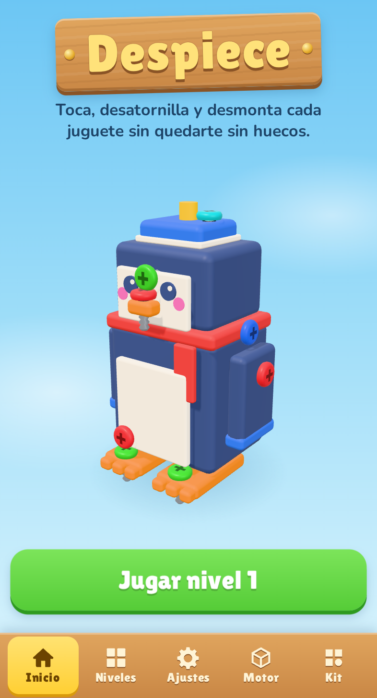
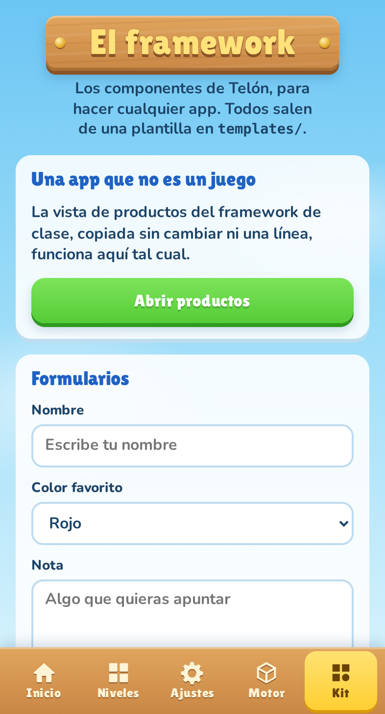
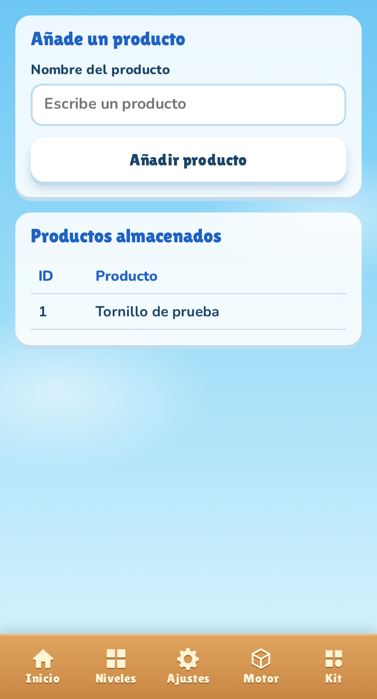
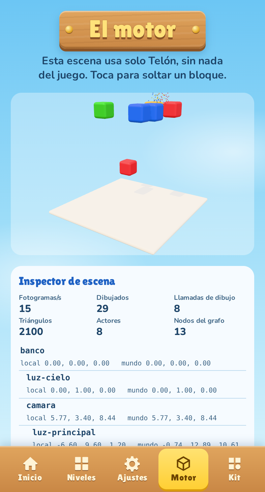
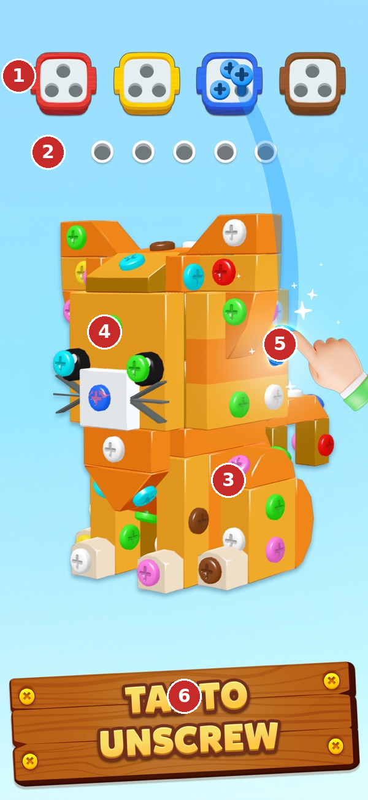
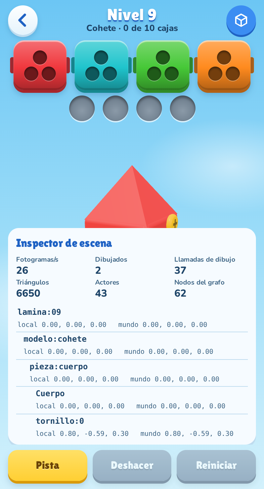
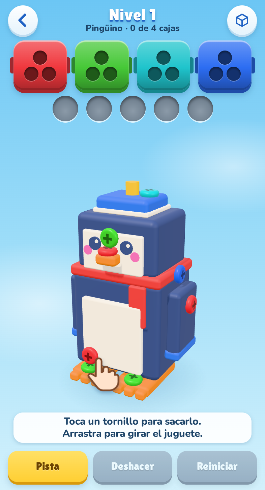
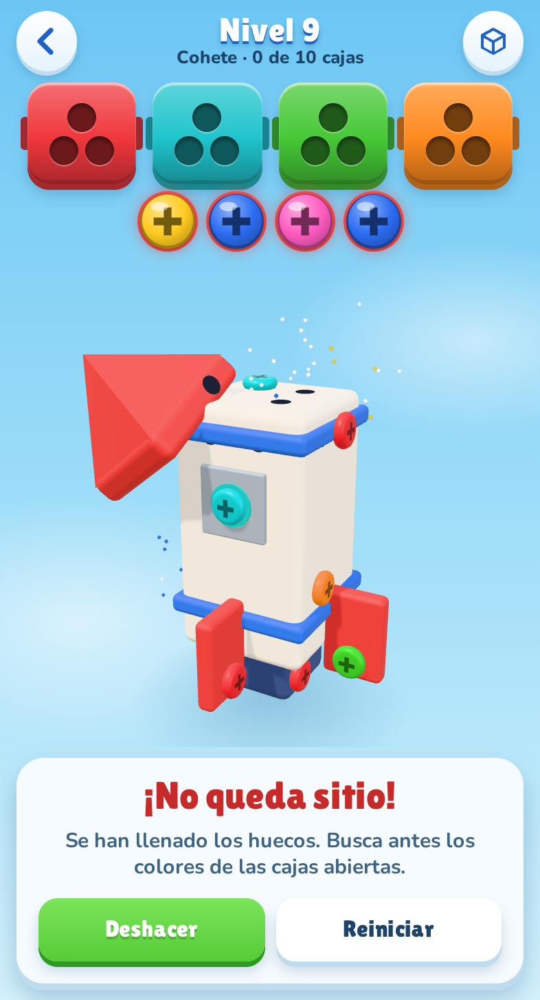
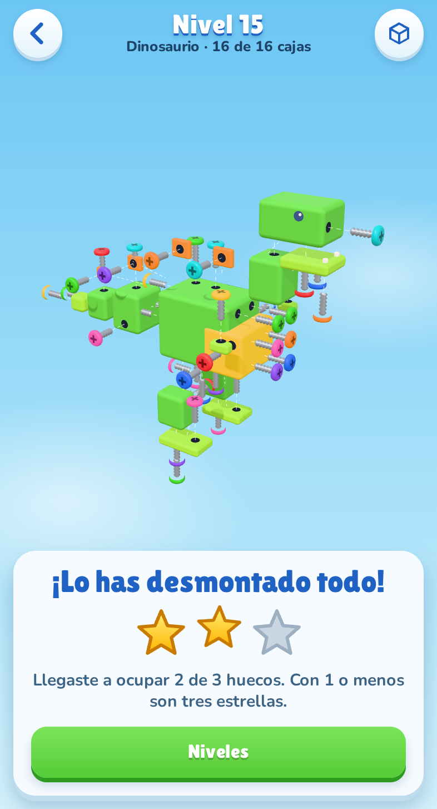
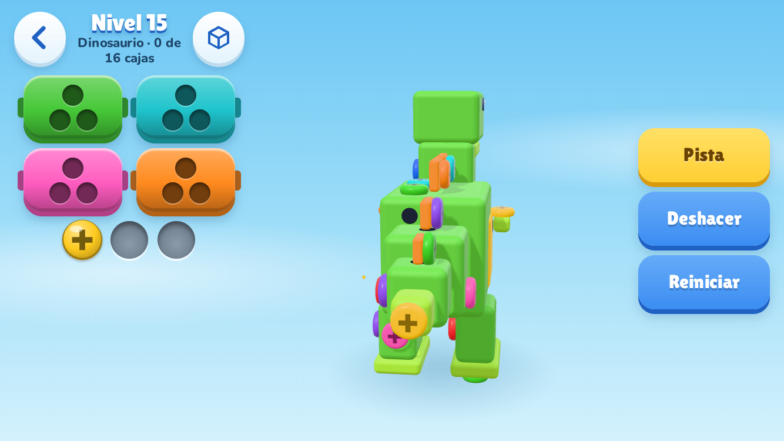

# Telón | móvil, y Despiece

**Módulo:** 0489 · Programación multimedia y dispositivos móviles
**Actividad:** crea tu propio framework móvil · RA4
**Resultado de aprendizaje 4:** Selecciona y prueba motores de juegos analizando la arquitectura de juegos 2D y 3D.
**Alumna:** Serena Sania Esteve · DAM · TAME Formación

---

## 1. Qué he hecho y por qué

El enunciado pide un framework móvil, y los criterios del RA hablan de motores de juegos. Para responder a las dos cosas con un solo proyecto, he unido lo que hemos construido por separado en clase:

- **El framework de vistas `jocarsa | móvil`** (carpeta 004, versión 016): vistas, controladores y componentes `ui-*`.
- **El motor `JOCARSA Motor`** (carpeta 001, versión 015): `Actor`, `Escena`, `Motor`, `Entrada` y `Camara`, con el juego separado en `js/juego/`.

El resultado es **Telón**, un framework móvil cuya capa de juego tiene la arquitectura de un motor. Para demostrar que funciona he hecho **Despiece**, un puzle 3D de desatornillar con 15 niveles. Toma el estilo visual y la mecánica de Screwdom 3D, pero sus modelos, sus niveles y todo su código son propios.

**Se puede jugar en** <https://tornillos3d.serenaesteve.com>, y se puede instalar en el móvil.



### Qué cambia respecto al framework de clase

He mantenido el contrato: `vistas/nombre.html`, `controladores/nombre.js` ejecutado con `new Function`, componentes `ui-*` con plantillas `{{variable}}`, carrusel y función de limpieza. También están las 17 plantillas de clase con sus mismos nombres, y 3 más propias.

Para comprobar que es compatible de verdad, `vistas/productos.html` y `controladores/productos.js` son **los archivos de clase de la versión 016, copiados sin cambiar nada**. Funcionan en Telón: añaden productos y los conservan al volver, y una prueba automática lo verifica. La pestaña **Kit** enseña todos los componentes y demuestra que el framework sirve para cualquier app, no solo para este juego.

 

Lo que he añadido parte de lo que faltaba para que fuera un framework de móvil, según nuestros propios apuntes de hardware:

| Tema de la unidad | Versión 016 de clase | Telón |
|---|---|---|
| «No hay clic, hay touch» | Navegación con botones | Deslizar entre pestañas; arrastre, toque y pellizco en `Entrada.js` |
| Modelo de estados | Solo limpieza al salir de una vista | Activo, pausa y destruido, con `alPausar`, `alReanudar` y `alDestruir` |
| Ciclo de vida | La vista se reinicia | La partida se guarda en cada jugada y se recupera tras cerrar la app |
| Botón atrás | No se gestiona | Historial del navegador; funciona con el «atrás» de Android |
| Menor rendimiento | Cada componente pide su plantilla, sin caché | Cada plantilla se pide una vez; en reposo no se dibuja nada |
| Hardware | No se usa | Vibración, inclinación, batería y audio, comprobando antes si existen |
| Sin conexión | No funciona | Instalable (PWA), con todo guardado en caché |
| Motor 2D con `canvas` | Teclado y radio de colisión | 3D sobre Three.js, con grafo de escena y selección por rayo |

He quitado la clase `Jugador` del motor de clase porque está pensada para un personaje controlado con teclado, y aquí no hay ninguno. Su función la cubren las acciones de `Entrada`.

---

## 2. Arquitectura de un juego 2D y 3D

Para identificar los elementos he partido de la lista que vimos en clase, y he comprobado cómo se resuelve cada uno en Despiece:

| Elemento | En Despiece | Archivo |
|---|---|---|
| Condiciones iniciales | Modelo montado, huecos de espera vacíos, cuatro cajas abiertas | `reglas.js` |
| Bucle de juego | `requestAnimationFrame`, con tiempo delta limitado a 50 ms | `Motor.js` |
| Clases | `Actor`, `Escena`, `Motor`, `Camara`, `Partida`, `Taller` | `js/motor`, `js/juego` |
| Escenario (salida visual) | Juguete 3D con aspecto de plástico, reflejos y sombras | `taller.js`, `Estudio.js` |
| Escenario (salida auditiva) | Clics, golpes y acordes sintetizados | `Sonido.js` |
| Interfaz | Cajas, huecos de espera y herramientas, hechas con el framework | `juego.js`, `templates/` |
| Sistema de entrada | Toque, arrastre, pellizco, teclado e inclinación | `Entrada.js` |
| Físicas (avanzado) | Gravedad en la caída de las piezas; colisiones en el banco de pruebas | `taller.js`, `Escena.js` |
| Partículas (avanzado) | Destellos al sacar un tornillo y confeti al ganar | `Particulas.js` |
| Postproducción (avanzado) | Solo el ajuste de tonos (*tone mapping*) de la imagen final | `Motor.js` |
| Condición de ganar | Todos los tornillos en sus cajas | `reglas.js` |
| Condición de perder | Se llenan los huecos de espera | `reglas.js` |
| Gestión de la frustración | Sin temporizador; pistas, deshacer y reinicio inmediato; primeros niveles en los que es muy difícil perder | `juego.js`, `niveles.js` |
| Gamificación | Hasta tres estrellas por nivel y desbloqueo progresivo | `progreso.js` |

### Qué cambia al pasar de 2D a 3D

Lo he comprobado al convertir el motor de clase, que es 2D, en uno 3D:

| Aspecto | 2D (motor de clase) | 3D (Telón) |
|---|---|---|
| Posición | `x, y` en píxeles | `x, y, z` en unidades del mundo |
| Rotación | Un ángulo | Tres ejes o un cuaternión |
| Cámara | Desplazamiento de un `canvas` | Proyección de perspectiva, con posición y encuadre |
| Dibujo | Órdenes `ctx.fillRect` en orden | Geometría, materiales y GPU; decide la profundidad |
| Coste de dibujo | Formas dibujadas | Llamadas de dibujo y triángulos |
| Colisión o selección | Comparar distancias | Lanzar un rayo desde la pantalla al mundo |
| Jerarquía | Lista plana de actores | Grafo: mover a un padre mueve a sus hijos |
| Pantalla a mundo | Directo | Hay que proyectar y desproyectar |

---

## 3. Componentes de un motor

La carpeta `js/motor/` es genérica. Una prueba automática comprueba que su código no contiene las palabras *tornillo*, *lámina*, *bandeja*, *pingüino*, *despiece* ni *molino*. Y para demostrarlo con hechos, la pestaña **Motor** de la app es una escena de bloques que caen y chocan, sin usar nada de `js/juego/`.



| Componente | Qué hace | Decisión pensada para móvil |
|---|---|---|
| `Motor` | Lienzo, tiempo, bucle, redimensionado | Solo dibuja si la imagen cambia; densidad limitada a 2×; si va lento, quita sombras y baja la resolución |
| `Estudio` | Iluminación: entorno, luz de cielo y luz principal | Calcula el entorno una vez; las sombras solo se recalculan cuando la imagen cambia |
| `Geometrias` | Cajas redondeadas y fusión de geometrías | Cada cabeza de tornillo es una sola llamada de dibujo |
| `Escena` | Actores, grafo, animaciones, colisiones, rayos | Solo compara colisiones entre actores que las usan |
| `Actor` | Unidad de escena con etiquetas y comportamientos | Un comportamiento terminado se elimina y deja de costar |
| `Camara` | Órbita con inercia | Encuadra por el lado corto: la pantalla es vertical |
| `Entrada` | Unifica dedo, ratón y teclado | Distingue toque de arrastre con un margen de 10 píxeles |
| `Particulas` | Partículas con depósito fijo | No reserva memoria mientras se juega, y evita tirones |
| `Recursos` | Geometrías y materiales compartidos | Todos los tornillos usan la misma geometría |
| `Sonido` | Audio sintetizado | No descarga archivos; se activa con el primer gesto, como exigen los móviles |
| `Inspector` | Árbol de escena y cifras en directo | Herramienta de análisis; no consume nada si está cerrado |

**Por qué Three.js y no un renderizador propio.** Lo vimos en clase, en el apartado de librerías para un motor. Three.js resuelve el dibujo, que es lo que más trabajo cuesta y menos enseña en este proyecto. Lo que he escrito yo es lo que hace que sea un motor: bucle, actores, entrada, cámara, recursos e inspector.

---

## 4. Entornos y motores analizados

Datos generales de cada herramienta. Las condiciones de licencia pueden cambiar, así que conviene revisarlas en la web oficial antes de elegir una para un proyecto real.

| Motor | Tipo | Lenguaje | Entorno de desarrollo | Móvil | Puntos fuertes | Limitación para este proyecto |
|---|---|---|---|---|---|---|
| **Unity** | 2D y 3D | C# | Unity Editor, con editor visual de escenas | Android e iOS, nativo | Es muy usado en juegos móviles; tienda de recursos enorme | Compila otra aplicación: no encaja con vistas y controladores web |
| **Godot** | 2D y 3D | GDScript, C# | Godot Editor, ligero | Android e iOS | Libre (MIT), sin regalías, con escenas en árbol | Igual que Unity: su interfaz no es la del framework |
| **Unreal** | Sobre todo 3D | C++, Blueprints | Unreal Editor | Android e iOS | Máxima calidad gráfica | Excesivo y pesado para un puzle en un móvil modesto |
| **Phaser** | 2D | JavaScript, TypeScript | Editor de código y navegador | Web y empaquetado | Muy ligero y maduro | Es solo 2D, y este juego necesita girar el modelo |
| **Three.js** | Librería 3D | JavaScript | Editor de código y navegador | Web y empaquetado | Muy extendida; es la que usamos en clase | No es un motor: no trae bucle, actores ni entrada. **Es lo que aporta Telón** |
| **A-Frame** | 3D declarativo | HTML sobre Three.js | Editor de código y navegador | Web | Muy rápido para empezar, orientado a realidad virtual | Pensado para escenas declarativas, no para un control fino de la selección |
| **JOCARSA Motor** | 2D | JavaScript | Editor de código y navegador | Web | Sencillo y didáctico; es la base de Telón | Es 2D y se maneja con teclado |

### Prueba práctica de cinco motores

El resultado de aprendizaje pide *probar* motores, así que hice la misma escena en cinco: un bloque que gira y cambia de color al tocarlo. Está en `pruebas/comparativa/`, y `pruebas/comparar_motores.py` lo mide todo en el mismo móvil emulado, con toques reales y tres repeticiones.

| Motor | Tipo | Líneas propias | JavaScript | Comprimido | Arranque | Responde al toque |
|---|---|---|---|---|---|---|
| **Telón** | 3D, motor propio sobre Three.js | 17 | 727 KB | 184 KB | 178 ms | Sí |
| **Three.js** | 3D, librería | 31 | 703 KB | 175 KB | 146 ms | Sí |
| **A-Frame** | 3D, declarativo | 15 | 1248 KB | 328 KB | 367 ms | Sí |
| **Babylon.js** | 3D, motor completo | 21 | 6930 KB | 1483 KB | 440 ms | Sí |
| **Phaser** | 2D, motor completo | 19 | 1168 KB | 308 KB | 266 ms | Sí |

Qué saco de la prueba:

- **Telón frente a Three.js:** añade solo 9 KB comprimidos y pide casi la mitad de código propio para la misma escena, porque ya trae el bucle, la cámara, la entrada y las luces.
- **Babylon.js** es el motor más completo, pero pesa unas ocho veces más que Telón. Para un puzle en un móvil modesto es demasiado.
- **A-Frame** es el que menos código pide, porque la escena se escribe en HTML. La primera vez mi toque no funcionaba: su cámara está a 1,6 m de altura, como una persona en realidad virtual, y el bloque no quedaba en el centro de la pantalla. El fallo era mío, y muestra para qué tipo de proyecto está pensado.
- **Phaser** es rápido y sencillo, pero el bloque es un rectángulo plano: no se puede girar un juguete 3D con el dedo.

Los tiempos de arranque se midieron con dibujo por software: sirven para comparar los motores entre sí, no como cifras de un móvil real. **Unity, Godot y Unreal no los he ejecutado**: son editores de escritorio que no tengo instalados, y sus datos de la tabla anterior son de consulta, no de prueba.

### Elección

| Necesidad | Consecuencia |
|---|---|
| Debe ser *mi* framework móvil | Descarta los motores cerrados con su propio editor |
| Debe girar un modelo 3D con el dedo | Descarta Phaser y el motor 2D de clase |
| Debe ser ligero para un móvil | Descarta Babylon.js, según la medición anterior |
| Debe compartir interfaz con las vistas `ui-*` | Lleva a tecnología web |
| Quiero controlar la selección y el dibujo | Three.js mejor que A-Frame |

Si el objetivo fuera publicar un juego comercial en las tiendas, elegiría **Godot** o **Unity**, por sus herramientas y su exportación nativa. Aquí el objetivo es entender y construir la arquitectura, y eso se aprende mejor escribiéndola.

### Mi entorno de desarrollo

Editor de código, navegador con emulación de dispositivo y Playwright para automatizar las pruebas. Un motor como Unity integra el editor de escenas, el inspector y el perfilador en un solo programa. Yo he tenido que construir la parte que necesitaba: la pestaña Motor y el `Inspector` hacen ese papel.

---

## 5. Análisis de un juego existente: Screwdom 3D

**Fuente y alcance.** He trabajado con la ficha pública del juego en App Store y sus capturas oficiales: Screwdom, de Zego Global Pte Ltd, publicado en enero de 2025, para iOS 15 o superior, de unos 844 MB. No tengo acceso a su código y la ficha no indica qué motor usa, así que **ese dato queda como desconocido**. Separo lo que se ve en la ficha de lo que deduzco del tipo de juego.

### Bloques funcionales

| Bloque | Qué hace en el juego | Origen |
|---|---|---|
| Reglas | Se toca un tornillo para sacarlo y va a la caja de su color; un mal orden puede bloquear la partida | Ficha y capturas |
| Interfaz de partida | Cuatro cajas de color con tres huecos en triángulo y cinco huecos grises debajo | Capturas |
| Contenido | Juguetes 3D de bloques: gato, caniche, pato, porción de tarta, flor y robot, entre otros | Capturas |
| Niveles | Dificultad creciente, sin límite de tiempo | Ficha |
| Monetización | Compras dentro de la aplicación | Ficha |
| Dibujo 3D | Muestra el modelo con tornillos en todas sus caras | Capturas, técnica deducida |
| Entrada táctil | Interpreta el toque sobre un tornillo y el giro del modelo | Deducido |
| Audio y animación | Respuesta a cada jugada | Deducido |
| Persistencia | Guarda el nivel alcanzado y lo comprado | Deducido |
| Gestor de escenas | Pasa del menú a la partida y al resultado | Deducido |

### Qué he tomado y qué no

Tomé de Screwdom su mecánica y su lenguaje visual: juguetes de bloques, cielo azul, madera, cuatro cajas y huecos de espera. Mis 15 juguetes, mis niveles, mis iconos y todo el código son propios. El número de huecos baja a cuatro y a tres en los niveles difíciles, y el final en vista de despiece es una aportación mía.

### Representación lógica y espacial de una escena

La **representación lógica** dice qué relación hay entre los elementos del juego; la **espacial**, dónde está cada uno. En un juego de este tipo son distintas: dos tornillos pueden estar muy cerca en el espacio y no tener ninguna relación en las reglas.

Sobre una captura oficial del juego, con los números añadidos por mí:



*Captura de la ficha de App Store de Screwdom, de Zego Global Pte Ltd, usada con fines de análisis.*

| Nº | Elemento | Representación lógica (deducida) | Representación espacial (lo que se ve) |
|---|---|---|---|
| 1 | Caja de color | Tiene un color y tres huecos; admite tornillos de ese color | Fija en la pantalla, en 2D: no gira con el modelo |
| 2 | Huecos de espera | Cinco plazas; llenarlas bloquea la partida | Fijos en la pantalla, en 2D |
| 3 | Pieza del cuerpo | La sujetan sus tornillos; cae cuando no le queda ninguno | En el mundo 3D, con volumen, luz y perspectiva |
| 4 | Pieza de la cabeza | Igual que la anterior, pero es otra pieza con sus propios tornillos | En el mundo 3D, unida a la anterior solo por su posición |
| 5 | Tornillo que se saca | Pasa de «sujeta una pieza» a «está en una caja» | Sale del mundo 3D y vuela por una estela curva hasta la interfaz 2D |
| 6 | Rótulo de madera | No forma parte de la partida: es publicidad de la ficha | Superpuesto a la captura |

El número 5 es el más interesante: es el punto en que el juego pasa un objeto de la capa 3D a la capa 2D. Despiece resuelve lo mismo proyectando la posición del tornillo a la pantalla y animando desde ahí una ficha de la interfaz.

Como no tengo el juego por dentro, la escena deducida de Screwdom es:

```text
Partida
├── Modelo 3D
│   ├── Pieza            transformación propia
│   │   └── Tornillo     posición relativa a su pieza; color
│   └── Pieza …
├── Casillas de color    interfaz sobre la escena
└── Cámara y luces
```

En **Despiece** he podido verificarlo, porque el `Inspector` muestra el árbol real en directo:



```text
lamina:09                 ← escena
├── modelo:cohete         ← raíz del modelo
│   ├── pieza:cuerpo      ← actor con formas y tornillos
│   │   ├── Cuerpo        ← malla
│   │   ├── tornillo:N    ← hijo de su pieza, en coordenadas locales
│   │   └── …
│   ├── pieza:nariz
│   └── …
├── particulas
├── luz-cielo
└── camara                ← lleva la luz principal como hija
```

- **Lógica:** la clase `Partida` de `reglas.js` no usa coordenadas. Solo sabe qué pieza sujeta cada tornillo, de qué tinta es y qué piezas lo bloquean. Por eso se puede probar sin dibujar nada.
- **Espacial:** el grafo sabe dónde está cada objeto. Cuando una pieza cae, cambia su posición y sus tornillos cambian de posición en el mundo, aunque la local siga igual. El inspector muestra ambas: `local` y `mundo`.
- **Dónde se unen:** los bloqueos no se escriben a mano. `calcularBloqueos` lanza un rayo desde cada tornillo y mira qué piezas encuentra, de modo que la geometría (espacial) genera las dependencias (lógica).

Las cifras de nodos, actores, llamadas de dibujo y triángulos de cada nivel se leen en directo en el inspector.

---

## 6. El juego

**Reglas.** Se saca un tornillo tocándolo. Si hay una caja abierta de su color, va allí; si no, a un hueco de espera. Una pieza sin tornillos cae y descubre lo que tapaba. Hay cuatro cajas abiertas y, al llenarse una, entra la siguiente. Si se llenan los huecos, hay atasco.

 

**Aspecto visual.** El objetivo era acercarse a Screwdom 3D. Lo que más lo consigue no es el color, sino cómo se trata la luz:

| Técnica | Efecto |
|---|---|
| Cajas con los bordes redondeados | Los bordes atrapan la luz y se leen como plástico |
| Mapa de entorno generado por código | Reflejos suaves, sin descargar imágenes |
| Luz de cielo y luz principal con sombras | Volumen, sin sombras negras |
| Cabezas abombadas con la cruz hundida | Tornillos que parecen objetos, no dibujos |
| Rosca visible al salir | El gesto de desatornillar se entiende |

Por defecto todas las cabezas llevan cruz, como en el original. Como eso deja el color como única pista, en Ajustes hay una opción de **marcas por color**, con una forma distinta para cada una.



**Un juguete por nivel.** Pingüino, seta, casita, coche, pez, radio, barco, tortuga, cohete, castillo, conejo, camión, molino, elefante y dinosaurio. Solo describo sus piezas, de dentro hacia fuera, y el juego coloca los tornillos sobre las caras. Un tornillo solo se acepta si lo tapan piezas de más fuera: así dos piezas nunca se bloquean entre sí y siempre existe un orden para desmontar el juguete. Radio, molino y pingüino conservan sus tornillos colocados a mano.

**Niveles con solución garantizada.** Un nivel generado al azar podría no tener solución. Por eso se construye al revés: primero se genera un orden válido de retirada y después se asignan los colores a partir de él. Ese orden es la prueba de que se puede resolver.

---

## 7. Adaptación al móvil

Un móvil no es un ordenador pequeño. Esto es lo que hace Telón para que el juego se comporte como una app:

| Situación en un móvil | Qué hace |
|---|---|
| Pantallas de 280 a 932 px, con la app girada o en tablet | Una prueba mide 10 tamaños: nada se sale, los botones miden 44 px o más y el juguete tiene sitio |
| Girar el móvil en mitad de una partida | En horizontal, el juguete va en el centro y los controles a los lados; los toques siguen acertando |
| Muesca y barra inferior del sistema | El diseño respeta las zonas seguras en los cuatro lados |
| Mantener pulsado, doble toque, pellizco | No sale el menú del navegador, no se amplía la página y no se selecciona el texto |
| Toque, arrastre y pellizco | Distingue los tres con dedos reales: girar o acercar no saca tornillos |
| Mala cobertura | Pantalla de carga inmediata, que no depende de ningún otro archivo; después funciona sin conexión |
| Pensar sin tocar nada | La pantalla no se apaga durante la partida, y se libera en segundo plano |
| El sistema le quita la tarjeta gráfica al cambiar de app | Se detiene sin fallar y, al volver, rehace los reflejos y sigue dibujando |
| Móvil lento | Mide los fotogramas mientras dibuja, quita las sombras y baja la resolución, y lo recuerda en las pantallas siguientes |
| Sonido en iPhone | El audio se desbloquea con el primer toque, sin perder ese primer sonido |
| Instalar | Botón en Ajustes en Android e instrucciones en iPhone; icono adaptable |



---

## 8. Pruebas y análisis de ejecución

`pruebas/ejecutar.py` hace **181 comprobaciones** en Chromium, emulando un Pixel 5 con toques reales. Las 181 pasan. Cubren las reglas, la navegación, los gestos, el historial, los estados, la recuperación tras cerrar, el modo sin conexión, los componentes, la vista de clase, el inspector y los desbordes de pantalla. También comprueban que todo tornillo libre se ve en cada jugada y que los 429 tornillos de los 15 niveles se pueden alcanzar con el dedo.

### Las pruebas cambiaron el juego

Medí la dificultad con dos jugadores simulados, de 300 partidas por nivel cada uno. Uno juega **al azar**, y otro está **atento**: saca primero un tornillo con caja abierta si lo hay, pero no planifica.

En la primera versión, **el jugador al azar ganaba el 100 % de las partidas en los 15 niveles**. El juego parecía correcto, pero no tenía dificultad: con los huecos llenos solo se rechazaba el toque, y casi siempre quedaba otro tornillo válido. Cambié la regla para que llenarlos sea un atasco, añadí más tornillos tapados y elegí las semillas de los niveles midiendo el resultado. Al pasar a cuatro cajas, como en Screwdom, el juego volvió a ser demasiado fácil, y tuve que subir la mezcla de colores y repetir la medición:

| Nivel | Modelo | Tornillos | Colores | Huecos | Tapados | Gana al azar | Gana atento |
|---|---|---|---|---|---|---|---|
| 1 | Pingüino | 12 | 4 | 5 | 3 | 100 % | 100 % |
| 2 | Seta | 12 | 4 | 5 | 5 | 100 % | 100 % |
| 3 | Casita | 15 | 5 | 5 | 10 | 100 % | 100 % |
| 4 | Coche | 21 | 6 | 5 | 13 | 86 % | 100 % |
| 5 | Pez | 24 | 7 | 5 | 10 | 59 % | 100 % |
| 6 | Radio | 27 | 7 | 5 | 12 | 41 % | 100 % |
| 7 | Barco | 27 | 7 | 4 | 21 | 36 % | 100 % |
| 8 | Tortuga | 30 | 8 | 4 | 16 | 16 % | 92 % |
| 9 | Cohete | 30 | 7 | 4 | 20 | 14 % | 90 % |
| 10 | Castillo | 33 | 8 | 4 | 19 | 3 % | 93 % |
| 11 | Conejo | 33 | 8 | 4 | 22 | 3 % | 80 % |
| 12 | Camión | 36 | 8 | 4 | 22 | 2 % | 84 % |
| 13 | Molino | 39 | 8 | 4 | 11 | 0 % | 72 % |
| 14 | Elefante | 42 | 8 | 3 | 23 | 0 % | 57 % |
| 15 | Dinosaurio | 48 | 8 | 3 | 26 | 0 % | 41 % |

Al principio era solo un modelo cada cinco niveles, y al cambiar de modelo la dificultad bajaba de golpe. Ahora cada nivel es un juguete distinto y la búsqueda de semillas penaliza cualquier nivel más fácil que el anterior, así que la dificultad sube de forma continua, con diferencias pequeñas que entran en el margen de la simulación (por ejemplo, entre los niveles 9 y 10 o entre el 11 y el 12). Una prueba automática falla si un nivel resulta claramente más fácil que el anterior. Son simulaciones: la dificultad real para una persona solo se conoce viendo jugar a personas.

### Otros fallos encontrados

- Tras una pantalla de error no se podía volver a la vista anterior, porque el framework creía seguir en ella.
- **Toques perdidos.** Un toque justo después de deslizar entre pestañas no hacía nada: el navegador lo usaba para frenar la inercia del gesto anterior. Medido: 0 de 5 toques funcionaban antes de 1,5 s. Ahora el framework toma el control del deslizamiento horizontal, y funcionaron 30 de 30, con esperas de 0, 300 y 1500 ms.
- **Niveles imposibles de terminar.** Probando el juego se atascaba el nivel 3: dos tornillos habían quedado por dentro del tejado, invisibles, y la casita no se podía acabar de desmontar. Mis pruebas no lo vieron, porque comprobaban que el toque llegaba al tornillo pero no que este se viera. Lo corregí y añadí una prueba más exigente: en cada jugada, siguiendo la solución y dos órdenes al azar, todo tornillo libre debe verse desde algún ángulo.
- Al generar los tornillos solos, alguno caía por la cara interior de una rueda, donde el dedo no llega. La prueba de alcance lo detectó, y ahora las ruedas solo llevan tornillo por fuera.
- Una pieza que caía se interponía en el rayo de selección y un toque fallaba: ahora las piezas sueltas no bloquean.
- La lista de niveles se pintaba casilla a casilla y los botones cambiaban de sitio; ahora se monta entera y se muestra de golpe.
- Las capturas revelaron que los tornillos tapados asomaban a través de los paneles y delataban lo que había debajo. Ahora no se muestran hasta que se destapan.
- En la pantalla final el panel tapaba la vista de despiece; ahora el lienzo se encoge y la cámara vuelve a encuadrar.

### Rendimiento

| Medida | Resultado | Qué significa |
|---|---|---|
| Dibujados por segundo en reposo | 0 | Con la escena quieta, la GPU no trabaja |
| Bucle en pausa | Detenido | En segundo plano no consume |
| Plantillas pedidas al navegar de nuevo | 0 | Cada una se pide una sola vez |
| Peso de la aplicación | Unos 1,5 MB, con Three.js y los dibujos de los niveles | Sin contar capturas, pruebas ni documentación |

### Qué no está comprobado

- **No se ha probado en un móvil físico.** Las pruebas son con emulación y dibujo por software, a unos 5 fotogramas por segundo. Esa cifra no representa a un móvil real, pero tampoco demuestra que uno modesto vaya fluido con las sombras. Por eso el motor baja la calidad solo si va lento. Esa reacción está probada simulando fotogramas lentos, no en un móvil lento de verdad. Tampoco se pueden comprobar aquí las zonas seguras de una muesca real ni el comportamiento propio de Safari en iPhone, como el pellizco o el desbloqueo del audio: están programados según su documentación.
- **Solo Chromium está verificado.** En Firefox, el entorno de pruebas no dispone de WebGL y solo pude comprobar que aparece el aviso correcto. WebKit, el motor del iPhone, no pudo arrancar en ese entorno.
- **Sensores.** Las pruebas simulan el hardware y comprueban que el juego llama a la vibración, crea el sonido y gira la cámara al recibir una inclinación. No he notado el efecto físico en un móvil: ni la vibración, ni si el sonido gusta.
- **Instalación.** Chromium no detecta errores en el manifiesto ni para instalar la aplicación, pero no la he instalado en un móvil.
- **Accesibilidad.** La interfaz se maneja con teclado y la mesa se gira con flechas, pero los tornillos solo se pueden elegir tocando o con el ratón.

---

## 9. Conclusiones

Lo que más me ha aportado es ver que un framework móvil y un motor de juegos resuelven el mismo problema con distinto nombre: ciclo de vida, entrada, recursos y dibujo, en un dispositivo con batería y memoria limitadas. Una vista del framework y una escena del motor tienen la misma forma.

También he aprendido que separar la lógica de los gráficos es lo que hace posible probar un juego. Por tener las reglas sin dibujo pude simular miles de partidas, y así descubrir que mi primera versión no tenía dificultad, algo que ninguna captura habría mostrado.

## 10. Fuentes

- Repositorio de la asignatura: [jocarsa/tame2627dam2](https://github.com/jocarsa/tame2627dam2), módulo 004, carpetas 001 y 004.
- Ficha y capturas de Screwdom en App Store: <https://apps.apple.com/app/id6740043080>
- Three.js 0.180: <https://threejs.org>
- Sitios oficiales de [Unity](https://unity.com), [Godot](https://godotengine.org), [Unreal Engine](https://www.unrealengine.com), [Babylon.js](https://www.babylonjs.com), [Phaser](https://phaser.io) y [A-Frame](https://aframe.io).
